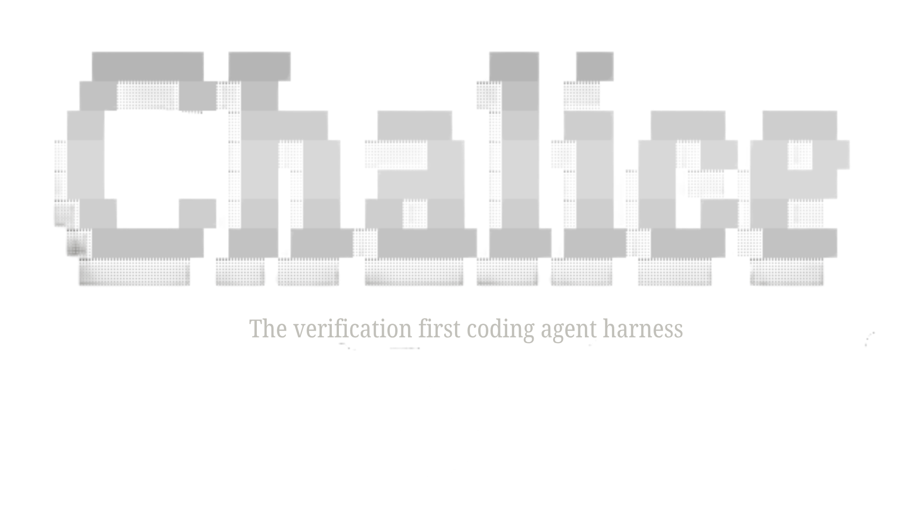
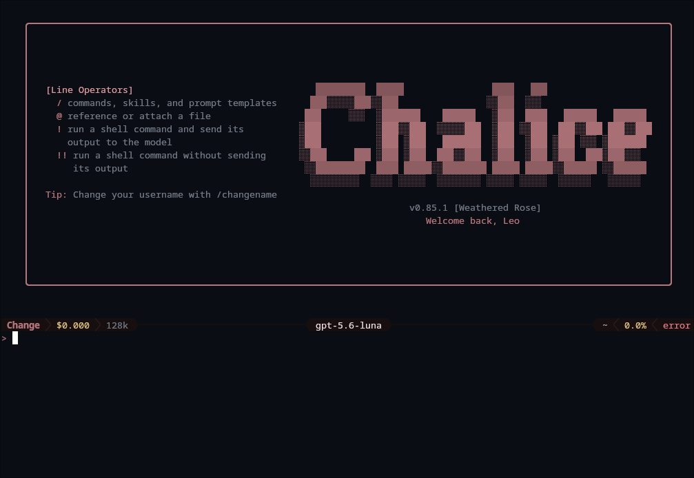
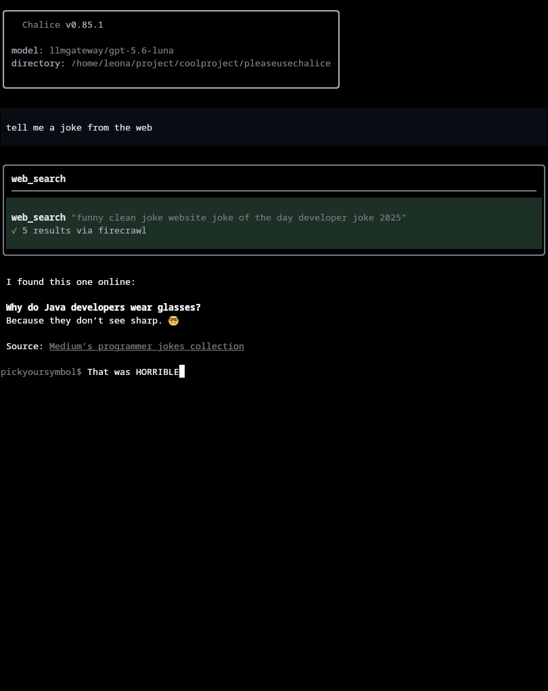
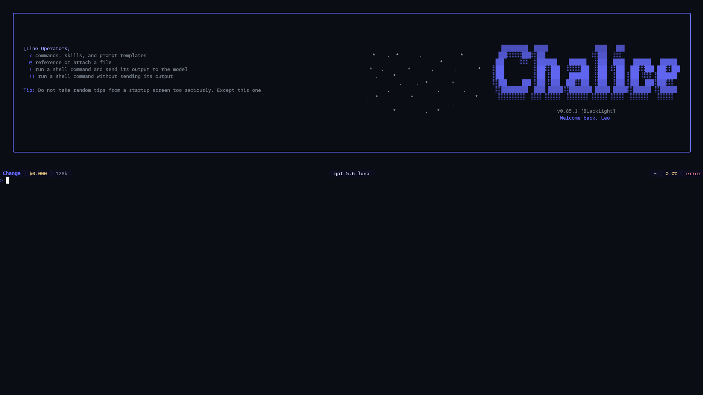

<p align="center">
  <a href="https://github.com/leolastforce/chalice">
    
  </a>
</p>

<p align="center">
  <a href="https://discord.gg/4Ks7m95EKP"></a>
  <a href="https://www.npmjs.com/package/@leolastforce/chalice"></a>
</p>

<div align="center">
  an opinionated lightweight agent harness built for control over the agent, token efficiency, and customizability
</div>

Insert cool chalice showcase gif here lol

- **Control**: Permission modes, planning, undo/redo, steering.
- **Token efficiency**: Semantic search, anchor-based editing, output truncation.
- **Workflow**: Focus on prompt → edit → answer rather than unnecessary autonomy.
- **Looks Customizability**: Themes, layouts, status bars, onboarding, and appearance settings.
- **Based on Pi**: The extension system works seamlessly! 

# Installation
Boot chalice up by running ```chalice``` in your preferred terminal! (sorry for making it hard)

Install with npm:
```npm install -g @leolastforce/chalice@1.0.6```

If you are an extraterrestrial being, please use telepathy instead:
```gloop glop glip gloop gloop chalice```

# Features
> Chalice uses the Pi provider system, which has 30~ different providers cleanly supported.

## Main Features
> Features most agent harnesses don't have
- Semantic File Indexing
- Undo / Redo tracking system for files
- Permission Modes: 
  - Build - The agent has full permissions in the current project directory "Everything the light touches is our kingdom"
  - Plan - The agent defines a plan and prompts you to accept the plan after you review it, you can then accept the plan for the agent to execute. "Execute order 66."
  - Ask - Asks you to confirm each bash command, edit, and write. Approved in-project bash runs inside the sandbox "It's may I use this tool, not can I use this tool."
  - YOLO - The agent has no restrictions at all, it's build mode except it can access exterior directories without restrictions. "fuck it we ball"
- Test methods tracking - To see how it works, go to like ## Clarification on some features
- Goal tracking (/goal)

## General Features
- Sub-agents
- Sessions
- Web Search Tools
- Steering
- Anchor Based Editing
- TODOs
- MCP Server Support
- Clean onboarding

## Secondary features
- The UI looks good (I hope)
- Looks customisation:
  - Themes
  - Status bar modes & Layouts
  - Status bar Position & optional line border setting
  - Welcome banner modes (Minimal, Full, none (/settings -> Welcome Banner type))
  - Displayed status bar stats visibility (/settings -> Below input bar stats)
  - Input indicator
- Username reference - What the agents and other features refer to you as (disable in /settings)
- Tool output truncation, anchor based editing, semantic searching, etc.. All contribute to optimising token usage - alongside the Pi agent loop

## Some appearance configuration examples:

<p align="left">
  <a href="https://github.com/leolastforce/chalice">
    
  </a>
</p>
<p align="left">
  <a href="https://github.com/leolastforce/chalice">
    
  </a>
</p>
<p align="left">
  <a href="https://github.com/leolastforce/chalice">
    
  </a>
</p>

## Tools
> Tools available in YOLO mode

| Name | Description |
| --- | --- |
| read | Read a text file |
| write | Create or overwrite a file |
| replace | Replace lines in a text file by anchor |
| insert | Insert lines into a text file by anchor |
| undo_last_change | Undo the last edit on a file |
| bash | Run a shell command |
| find | List files by path and name |
| anchor_grep | Search files with ripgrep |
| semantic_code_search | Search the codebase by meaning |
| list_code_tags | List declared code tags |
| todo | Manage a todo list |
| web_search | Search the live web |
| web_fetch | Fetch a web page or PDF as text |
| request_network_access | Request network access for specified domains |
| show_plan | Render a plan Markdown file for review |
| mcp | Install, inspect, and call MCP servers |
| mcpScript | Batch several MCP tool calls in one JavaScript request |
| multi_tool_use.parallel | Run independent tools in parallel |
| subagent | Delegate work to a child agent |
| subagents_enable | Enable subagent delegation and management tools |
| bg_wait | Wait for background work to finish |
| subagent_supervisor | Reply to child agent requests |

# Credits

Chalice is made by leolastforce
Chalice is based on Pi and several other user repos, see [CREDITS.md](CREDITS.md)

# Support
... Starring the repo and sharing it with your friends is greatly (somewhat) appreciated, suggestions are amazing, but the best thing you can do: Is simply use Chalice! (... I didn't know what else to say, but yea I would go crazy if I saw someone use Chalice that I didn't know lol)
Thanks for reading the README, but in the future, probably don't go around reading every single README just because it's called README and you're trying to be nice, but... We do need more people like you! 

- Leo out
