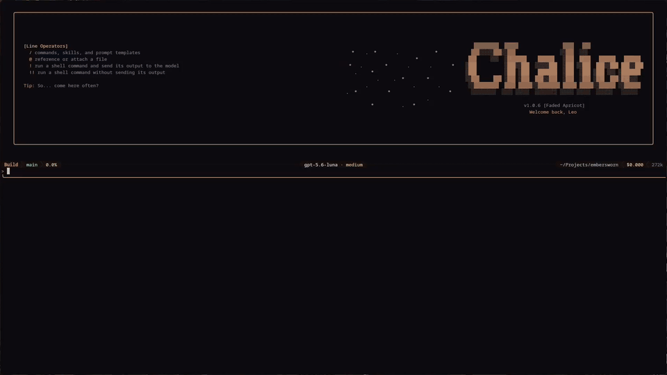

<p align="center">
  <a href="https://github.com/leolastforce/chalice">
    
  </a>
</p>

<p align="center">
  <a href="https://discord.gg/4Ks7m95EKP"></a>
  <a href="https://www.npmjs.com/package/@leolastforce/chalice"></a>
</p>

<div align="center">
  An opinionated, lightweight coding agent built for control, token efficiency, and customizability.
  <br>
  <br>
</div>

<div align="center">
  <table>
    <tr>
      <td align="center">
        
      </td>
    </tr>
  </table>
</div>

<br>

- **Control**: Permission modes, planning, undo/redo, steering.
- **Token efficiency**: Semantic search, anchor-based editing, output truncation.
- **Workflow**: Focus on prompt → edit → answer rather than unnecessary autonomy or long lived goals.
- **Looks Customizability**: Themes, layouts, status bars, onboarding, and appearance settings.
- **Based on Pi**: The extension system works seamlessly! 

# Installation

Install with npm:
```npm install -g @leolastforce/chalice@1.0.6```

If you are an extraterrestrial being, please use telepathy instead:
```gloop glop glip gloop gloop chalice```

Boot chalice up by running ```chalice``` in your preferred terminal! (sorry for making it hard)

# Features
> Chalice uses the Pi provider system, which has 30~ different providers cleanly supported.

## Main Features
> Features most agent harnesses don't have
- Semantic File Indexing
- Undo / Redo tracking system for files
- Permission Modes:
  - **Build** - The agent has full permissions inside a sandbox in the current directory
  - **Plan** - The agent defines a plan and prompts you to accept the plan after you review it, you can then accept the plan for the agent to execute.
  - **Ask** - Asks you to confirm each bash command, edit, and write. Approved in-project bash runs inside the sandbox
  - **YOLO** - The agent has no restrictions at all, it's build mode except it can access exterior directories without restrictions. "fuck it we ball"
- Test methods tracking

## General Features
- Sub-agents
- Sessions
- Web Search Tools
- Steering
- Anchor Based Editing
- TODOs
- MCP Server Support
- Clean onboarding

## Secondary features
- The UI looks good (I hope)
- Appearance Customisation:
  - Themes
  - Status bar modes & Layouts
  - Status bar Position & optional line border setting
  - Welcome banner modes (Minimal, Full, none (/settings -> Welcome Banner type))
  - Displayed status bar stats visibility (/settings -> Below input bar stats)
  - Input indicator
- Username reference - What the agents and other features refer to you as (disable in /settings)
- Tool output truncation, anchor based editing, semantic searching, etc.. All contribute to optimising token usage - alongside the Pi agent loop

## Tools
> Tools available in YOLO mode

| Name | Description |
| --- | --- |
| read | Read a text file |
| write | Create or overwrite a file |
| replace | Replace lines in a text file by anchor |
| insert | Insert lines into a text file by anchor |
| undo_last_change | Undo the last edit on a file |
| bash | Run a shell command |
| find | List files by path and name |
| anchor_grep | Search files with ripgrep |
| semantic_code_search | Search the codebase by meaning |
| list_code_tags | List declared code tags |
| todo | Manage a todo list |
| web_search | Search the live web |
| web_fetch | Fetch a web page or PDF as text |
| request_network_access | Request network access for specified domains |
| show_plan | Render a plan Markdown file for review |
| mcp | Install, inspect, and call MCP servers |
| mcpScript | Batch several MCP tool calls in one JavaScript request |
| multi_tool_use.parallel | Run independent tools in parallel |
| subagent | Delegate work to a child agent |
| subagents_enable | Enable subagent delegation and management tools |
| bg_wait | Wait for background work to finish |
| subagent_supervisor | Reply to child agent requests |

# Credits

Chalice is made by leolastforce
Chalice is based on Pi and several other user repos, see [CREDITS.md](CREDITS.md)

# Supporting
- ... Starring the repo and sharing it with your friends is greatly (somewhat) appreciated, suggestions are amazing, but the best thing you can do: Is simply use Chalice! (... I didn't know what else to say, but yea I would go crazy if I saw someone use Chalice that I didn't know lol)
- Thanks for reading the README, but in the future, probably don't go around reading every single README just because it's called README and you're trying to be nice, but... We do need more people like you! 

Have a good day, -Leo out

# Documentation

# Undo / Redo

## Overview on how Undo / Redo works

Undo and redo works by tracking user prompt cycles, when a cycle changes files, a snapshot is saved about which files belong to that conversation turn.
- When in a git repository, it tracks changes and normal files that are not ignored, which includes changes made by shell commands, which is the main differentiator.
- When it ISN'T in a git repository, Chalice only snapshots paths that were directly used by Chalice's edit tools; edit, write, which means shell created files and edits are not covered, you will get a notice though.

TLDR: It works with the shadow git repo method.

## Dirty guard

Before restoring, there is a check for non snapshotted changes that could be overwritten, if there are, the redo is blocked.

## Session Tree

A relatively simple thing to account for if you've used Pi in the past to get in your head: Undo / Redo are linked to the session tree (/tree or Esc + Esc quickly), meaning _moving to another point in the thread restores the workspace state snapshot associated with it_

# Test Methods

## Overview on how test methods works
Test Methods lets a project describe how its tests should be run, then gives those instructions to Chalice before it starts working on a prompt.

Create a TESTMETHODS.md file in the project's root

> Example:
```md
Before considering a feature complete:
- Run the unit tests.
- Run the formatter.
- Run the type checker.
```

## Session control

Test-method prompting is enabled by default when `TESTMETHODS.md` contains content. Use the command below to control it for the current session:

```text
/dotestmethods       toggle prompting
/dotestmethods true  enable prompting
/dotestmethods false disable prompting
```

The setting is stored in the session tree, so it follows the current session history. If `TESTMETHODS.md` is missing or empty, no test-method instructions are added (grass is green).

## Why use this?
The main incentive is that you can enable and disable the instructions unlike AGENTS.md without really having to explicitly tell the agent to or not to run tests with whatever contents TESTMETHODS.md contains.

It isn't inherently a strong feature, more so quality of life, nonetheless, it doesn't hurt to just leave it blank! (that's what /goal said and look what happened to it lol)

TLDR: TESTMETHODS.md separates optional test-execution instructions from general project guidance.

# Subagents

## Overview on how subagents works
A subagent is a separate Chalice instance which is given a specific task, probably by the main agent. The session you are currently in is in charge of it, and chooses whether to delegate, what task to give the child, and of course what to do with the result.

## "Agents"
An agent is literally a markdown file which has a system prompt and settings (optional), for example it's name, tools, and model.

These are the built in subagents meant for common jobs:
- The "scout" - Maps relevant files, code paths, and risks
- The "worker" - Literally just an implementer for assigned changes
- The "reviewer" - It's in the name (checks changes and reports problems)
- The "oracle" - Peer pressure final boss, challenges whatever is assigned (for example a plan) without editing files
- The "researcher" - Gathers external information, which needs web tools available in the child session (the child being the subagent)

## Workflows
So for example, you are making a change that needs more than one pass, a pattern could be: 

clarify to scout to worker to reviewers to worker

> The parent can do independent tasks at the same time, or also wait for a result before starting the next. Worktree isolation could give writing children seperate Git worktrees when changes in parallel should not share the same files, which I like to do!

## Background work
Subagents running in the background _continue even after the main agent finishes a prompt cycle / returns control_. They report their status and result back to the session that started them, so you can inspect a run or its transcript, send feedback / guidance, or simply just stop it.

## Something to note
Agents using... subagents is not automatic and I hope you know that, asking for subagents or giving them a task several steps, does not mean the parent should launch one, so.. You should give the parent clear instructions when you DO want it to delegate.

_Example_
> Have a scout inspect the change, ask worker to implement it, then have reviewer check the result

Conclusion: Subagents make you feel productive and cool and they are also useful so... Why not use them? (but make sure to actually use them when they are.. Useful, otherwise it's counter-intuitive)
